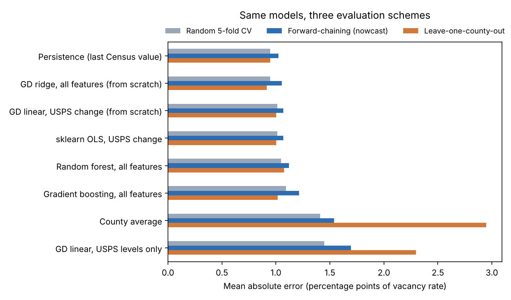
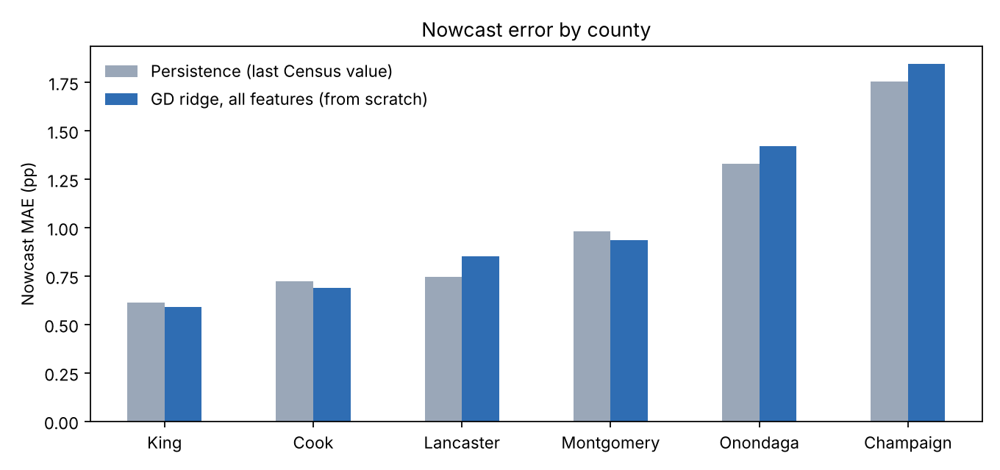
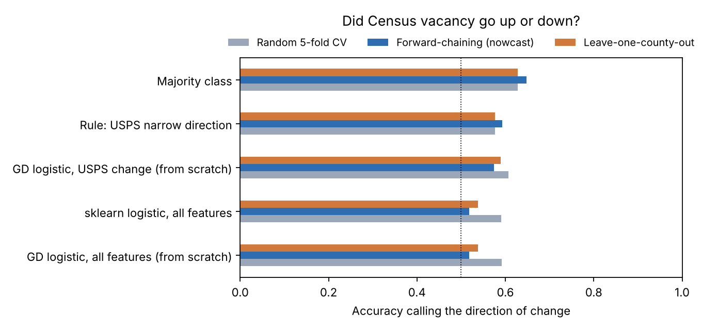
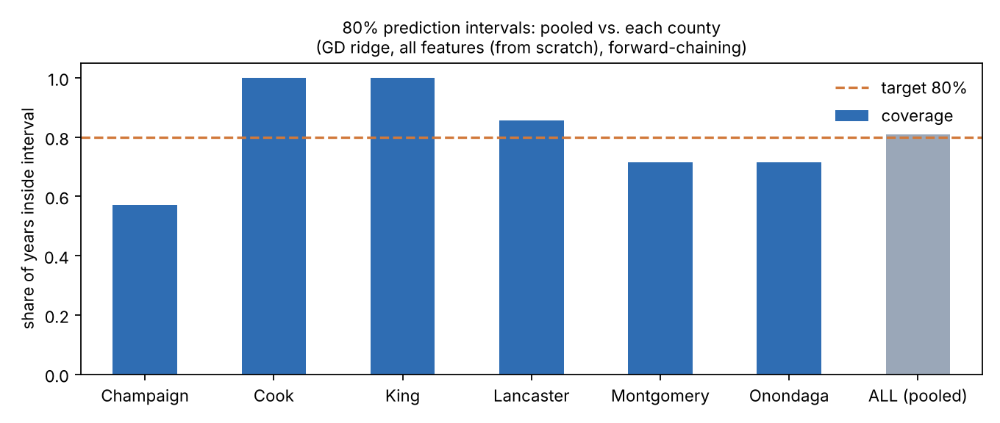

# Can a Model Nowcast Census Vacancy from Mail Data? An Honest Evaluation


**In one sentence:** my earlier project showed that U.S. Postal Service vacancy counts are
not a substitute for the Census Bureau's vacancy rate. This project asks the next question:
can a model that combines last year's Census number with this year's USPS movement *predict*
this year's Census rate, and does the answer hold in every county?

**Short answer:** no, not yet. Across eight models, none beat simply carrying last year's
Census value forward when evaluated the way a real nowcast would be used. Two of the three
evaluation schemes say my best model ties or wins. Only the realistic one says it loses.

Companion project (data collection, Fabric pipeline, Power BI dashboard):
[can-mail-data-predict-housing-vacancy](https://github.com/thanhvu911/can-mail-data-predict-housing-vacancy)

## Why this matters

At EDC Lancaster County's Center for Regional Analysis, most economic series arrive a month
or two after the period they cover. The Census Bureau's 1-year ACS vacancy estimate arrives
once a year, about nine months after the year ends. USPS data comes out every quarter. If a
model could turn USPS data into a reliable early estimate, a local economic development
office could see housing problems sooner. If it can't, it is better to know that before
anyone acts on its numbers.

## What is in this repo

| Part | What it does | Course link |
|---|---|---|
| `src/pipeline.py` | Raw Census CSVs → **bronze** (raw union) → **silver** (typed, rate recomputed from counts, joined to USPS) → **gold** (model table built with SQL window functions). Runs **15 data-quality checks** and stops if any fail. | Project 1: cleaning, preprocessing pipeline |
| `DATASHEET.md` | A Datasheet for Datasets: motivation, composition, collection, preprocessing, uses. | Project 1: Datasheets for Datasets |
| `src/gd.py` | **Linear and logistic regression trained with gradient descent, written from scratch** in NumPy. | Project 3: gradient descent, learning rates, logistic regression |
| `tests/` | Checks that my gradient-descent linear regression matches the closed-form least-squares solution, that my logistic regression matches scikit-learn with the same penalty, that the pipeline checks pass, and that the gold table has no look-ahead. | |
| `src/evaluate.py` | Eight regression models and five direction classifiers, each evaluated three ways, with per-county errors, confusion matrices and conformal prediction intervals. | Projects 2–3: comparing my code to scikit-learn |

## Data

- **Census:** ACS 1-year estimates, table B25002 (occupancy status), six counties,
  2010–2019 and 2021–2024 (no 1-year release for 2020). Vacancy rate = vacant ÷ total
  housing units, recomputed from the raw counts.
- **USPS:** HUD's aggregation of the USPS Vacant Address data, averaged from four quarters to
  one annual rate per county: a *narrow* rate (vacant ÷ total addresses) and a *broad* rate
  (adds "No-Stat" addresses).
- **Counties:** Champaign (IL), Cook (IL), King (WA), Lancaster (PA), Montgomery (OH),
  Onondaga (NY). 84 county-years, 78 once each county's first year is used as a lag.

Two data issues shape the modeling:
1. **2012 definition change.** USPS changed how it classifies No-Stat addresses in 2012, and the
   broad rate jumps 2.2–4.9 points that year in every county. The pipeline zeroes out that
   year's broad-rate change and adds a post-2012 flag, so a model cannot learn a fake trend.
2. **The 2020 gap.** 2021 is compared to 2019, and the gold table records a two-year gap.

## How I evaluated

For year *t*, every model may use only what would be known before the Census release:
last year's Census rate, plus this year's and last year's USPS rates.

| Scheme | What it means | Why it matters |
|---|---|---|
| Random 5-fold CV (×20) | Shuffle all county-years | What most tutorials report. It lets the model learn from 2023 to predict 2016. |
| **Forward-chaining** | To predict year *t*, train only on years before *t* (test years 2015–2024) | **This is how a nowcast would actually be used.** |
| Leave-one-county-out | Train on five counties, test on the sixth | Can it work in a county it has never seen? |

## Results

### 1. No model beats persistence in a real nowcast

Mean absolute error, in percentage points of vacancy rate (lower is better):

| Model | Random CV | **Forward-chaining** | Leave-one-county-out |
|---|---|---|---|
| Persistence (last Census value) | 0.947 | **1.023** | 0.947 |
| GD ridge, all features (from scratch) | 0.945 | 1.054 | 0.914 |
| GD linear, USPS change (from scratch) | 1.012 | 1.067 | 1.003 |
| scikit-learn OLS, USPS change | 1.012 | 1.067 | 1.003 |
| Random forest | 1.048 | 1.119 | 1.075 |
| Gradient boosting | 1.094 | 1.215 | 1.017 |
| County average | 1.408 | 1.538 | 2.946 |
| GD linear, USPS levels only | 1.449 | 1.696 | 2.296 |



- My ridge model **ties persistence under random CV (0.945 vs. 0.947) and beats it under
  leave-one-county-out (0.914)**. Both schemes let it train on years later than the one it
  predicts. Under forward-chaining it is **3% worse** than persistence.
- The tree models do worse than the linear ones. With 78 rows there is not enough data for
  them to find structure that holds up.
- "County average" looks reasonable under random CV (1.41) and falls apart on a new county
  (2.95). Most of what it knows is which county it is in.
- My from-scratch gradient-descent model gives the same predictions as scikit-learn's OLS
  (identical errors to three decimals), which the tests also check.



### 2. Calling the direction: the best "model" is always guessing "down"

The original project found that USPS moved the same way as Census 57.7% of the time. Could a
logistic regression do better?

| Classifier | Random CV | **Forward-chaining** | Leave-one-county-out |
|---|---|---|---|
| Majority class (always "down") | 0.628 | **0.648** | 0.628 |
| Rule: USPS narrow direction | 0.577 | 0.593 | 0.577 |
| GD logistic, USPS change (from scratch) | 0.607 | 0.574 | 0.590 |
| GD logistic, all features (from scratch) | 0.592 | 0.519 | 0.538 |



Census vacancy fell in 63% of county-years, so always guessing "down" wins. The logistic
model with USPS changes predicts "up" only 10 times in the forward-chaining test and gets 3
of them right (confusion matrices in
[`results/confusion_matrices__forward.md`](results/confusion_matrices__forward.md)).
Adding more features makes it worse, which looks like overfitting on a small sample.

### 3. An 80% interval that is 80% overall and 57% in Champaign

I built split-conformal 80% prediction intervals, calibrated only on earlier years. Pooled
over all counties, they cover the true value **81%** of the time, which looks correct.
County by county, the coverage ranges from **57% (Champaign)** to 100% (Cook, King).



An office using these intervals in Champaign County would be wrong much more often than
the label says, and the pooled number would not warn them.

### What I take from it

1. **The evaluation choice decided the conclusion.** Two of three standard schemes would
   have let me report a small win. Only the scheme that matches real use showed a loss.
2. **A pooled number can hide the place a model serves worst**, both for point errors and
   for interval coverage.
3. **The target may be mostly noise.** The median year-over-year change in the Census rate
   is 0.66 points, and ACS 1-year county estimates can carry sampling error of a similar size,
   especially in smaller counties like Champaign (I did not download the margins of error, so I can't separate the two here). Persistence
   may be hard to beat simply because there is little real signal left to predict.

### Limitations and next steps

- **78 rows and 6 counties.** Every conclusion here is small-sample. The natural next step is
  more counties: the same pipeline works for any county with an ACS 1-year estimate.
- **Add ACS margins of error.** This would show how much of the error is Census sampling noise,
  and allow weighting each year by its uncertainty.
- **Use the quarterly USPS series directly** instead of the annual average, so the most recent
  quarter can carry more weight.

## Reproduce

```bash
pip install -r requirements.txt
python src/pipeline.py      # builds data/bronze, silver, gold; prints 15 checks
python src/evaluate.py      # writes results/*.csv and figures/*.png (about a minute)
python -m pytest -q tests   # 5 tests
```

All randomness is seeded. Outputs from my run are committed in `results/` and `figures/`.

## Repo layout

```
data/raw/        Census CSVs (one folder per county), USPS annual rates, published reference rates
data/bronze|silver|gold/   pipeline outputs
src/pipeline.py  bronze → silver → gold, data-quality checks (SQL in SQLite)
src/gd.py        gradient-descent linear and logistic regression (NumPy)
src/evaluate.py  models × evaluation schemes, intervals, figures
results/         metrics, per-county tables, confusion matrices, data-quality report
figures/         charts used above
tests/           correctness tests
DATASHEET.md     datasheet for the dataset
```
